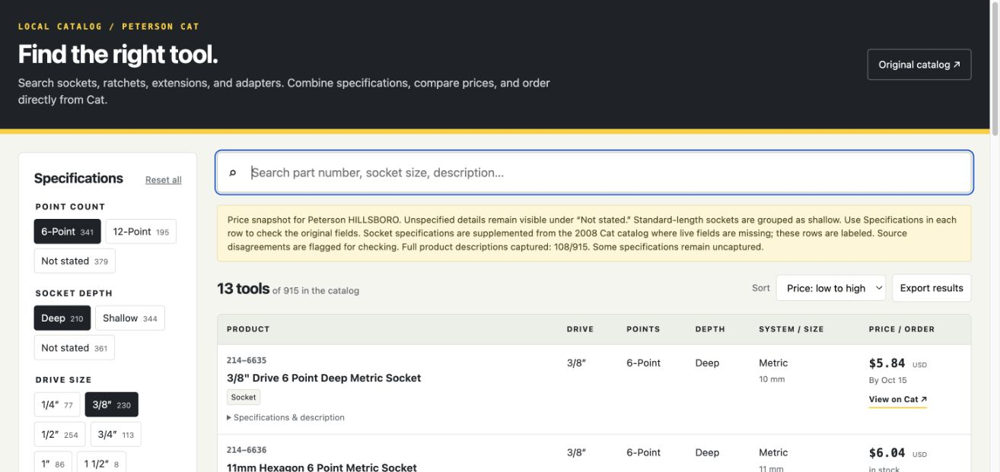

# Cat Tool Finder

A portable search tool for the Peterson Cat **Ratchets & Sockets** catalog. Filter by point count (6 or 12), socket depth, drive size, Metric/SAE, tool type, impact use, finish, and price. Search by part number or description, sort by price, and export matching results as CSV. Ordering links open the original Cat product pages.



## Use

Download `index.html` and open it in a browser. The file contains all data, styling, and search logic. No installation, login, or server is needed to search it. Ordering on Cat may require a login.

Multiple choices within a filter match any selected value; different filter groups must all match. Price limits are inclusive. Part numbers work with or without their hyphen. **Include products with unspecified values when filtering** retains possible matches whose captured specifications are incomplete.

## Data and limits

- **915 products** from Peterson's Ratchets & Sockets category.
- **913 USD prices**, captured while logged in to **Peterson Hillsboro** on **October 10, 2026**. These are a historical snapshot and may differ from another account, branch, or current price. `385-8586` and `456-2109` had no listed price.
- **108 full product descriptions**, plus the category listings and their US/metric specification views. Cat denied further detail requests even at one page every 10–15 seconds; collection stopped.
- Socket tables in the [2008 Cat Shop Supplies and Hand Tools catalog (PECJ0003-01)](https://downloads.ctfassets.net/japba5fc4y8x/10z4rNCa2s5l2eXrKEBEHP/42ff1f3d285f7346364845b21a163a7f/PCC_Tools_and_Supplies_Booklet.pdf) match **448 current part numbers**. Missing fields supplemented from this older source are labeled, and each product links to its source PDF page. Current website values take precedence; disagreements are flagged.

Impact use and finish are separate filters. Impact requires explicit tool-use wording or an impact-socket heading in the older Cat catalog; hand/non-impact requires explicit hand-use or non-impact wording. Chrome finish and black oxide alone do not establish impact suitability. Chrome-molybdenum and chrome-vanadium alloy names do not establish a chrome finish. Missing use/finish values can be supplemented from explicit catalog headings; their source is shown in the product details and CSV export.

Uncaptured or unstated specifications remain **Not stated**. Standard-length sockets map to Shallow; explicit deep/deep-well sockets map to Deep. Drive size is kept separate from fastener size. Catalog footnotes override table headings; an ambiguous table heading that mixes 6- and 12-point parts is not used to assign point counts.

Confirm current price, availability, and specifications on Cat before ordering. Opening the finder does not refresh the snapshot. It makes no automatic network requests; source and ordering links require network access. No credentials, cookies, account identifiers, or authentication data are included.

## Development

Node.js is sufficient; there are no package dependencies.

```sh
node build.js
node verify.js
```

`catalog.json` is the publication dataset. `catalog-core.js` contains classification and filter logic; `template.html` contains the interface. The build embeds those files into the standalone `index.html` and writes a coverage report. Verification checks combined filters, source disagreements, mixed-number drive sizes, unique product IDs, links, branch consistency, and generated JavaScript.

The raw capture logs and complete reference PDF are excluded from this repository. This is an independent tool; product information comes from Caterpillar and Peterson, and all orders take place on Cat's website.
